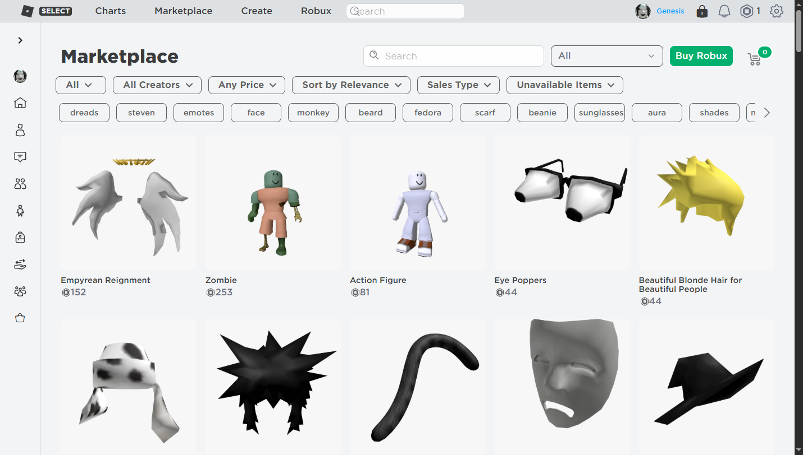
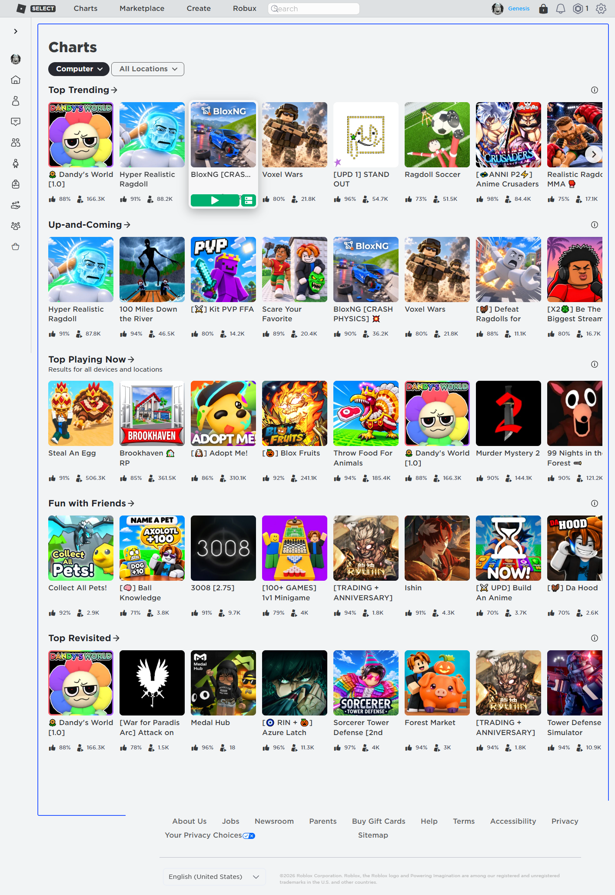
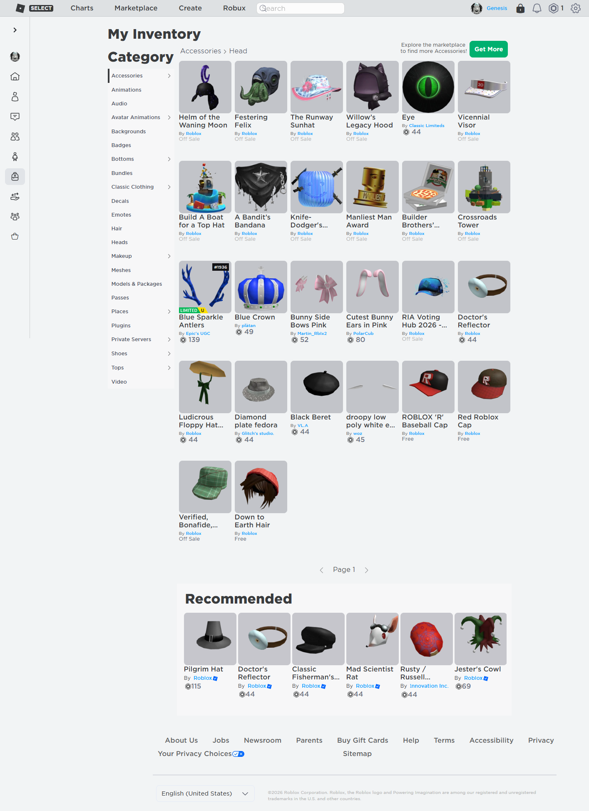
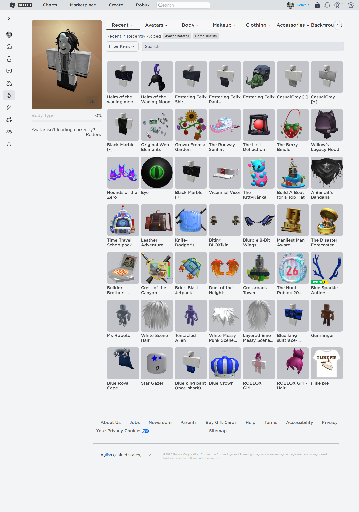
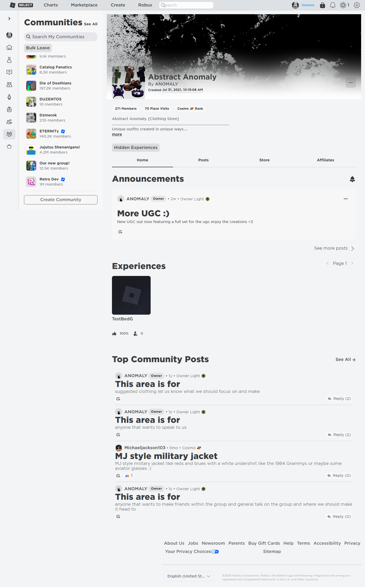

# Roblox 2021M Recreation

A UserCSS theme that brings back the May 2021 Roblox website: the old header, Gotham SSm, the green play buttons, and the light and dark palettes.

## Install

1. Install [Stylus](https://addons.mozilla.org/firefox/addon/styl-us/) for Firefox or [Stylus](https://chromewebstore.google.com/detail/stylus/clngdbkpkpeebahjckkjfobafhncgmne) for Chrome.
2. Open [roblox-2021m.user.css](https://raw.githubusercontent.com/GenesisHelium/2021M-Roblox-Recreation/main/roblox-2021m.user.css).
3. Click "Install style" on the page that opens.

## Screenshots

  
  
  
  

More in [`screenshots/`](screenshots).

## What it covers

- Header, navigation, and the 2021 logo
- Buttons, forms, cards, and content grids
- Left navigation drawer, footer, modals, and tooltips
- Landing page, error pages, and the responsive layout
- Light and dark themes

The fonts and images are the original rbxcdn files embedded in the style, so it makes no network requests of its own.

## Notes

Compatible with the [RoValra](https://rovalra.com) extension.

Roblox changes its markup often, so some pages may still show newer elements. Some parts of the site are still missing and will be added soon. The style is scoped to roblox.com and does not touch other sites.

## Contributing

Suggestions, pull requests, and fixes are welcome. [Open an issue](https://github.com/GenesisHelium/2021M-Roblox-Recreation/issues) or send a pull request.

## License

[PolyForm Noncommercial 1.0.0](LICENSE). You can use and modify the style for noncommercial purposes. Roblox, the Roblox logo, and the site assets belong to Roblox Corporation.

## Credits

Built from Wayback Machine captures of roblox.com and rbxcdn from May 2021.
